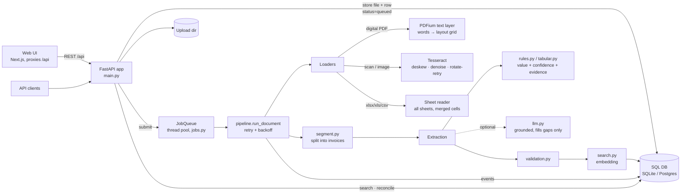
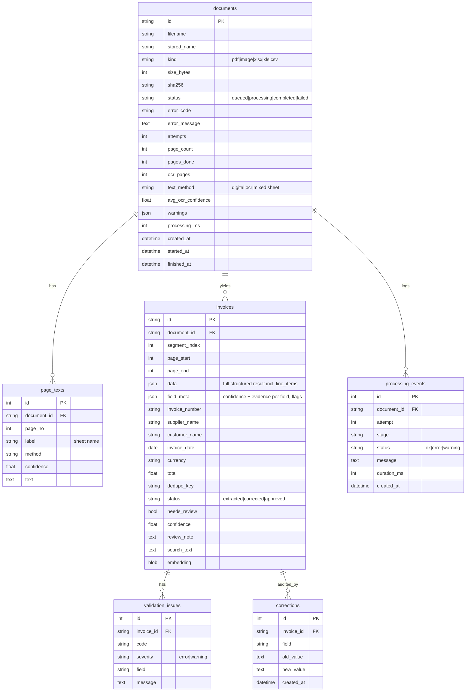

# Architecture

## Components

### Document lifecycle

`queued → processing (load → extract → persist) → completed | failed`. Each stage writes a `processing_events` row (stage, attempt, status, duration), so the
UI can show progress and history. Transient errors (OCR timeout, locked DB, LLM 5xx) retry with exponential backoff up to
`MAX_ATTEMPTS`; permanent errors (`corrupted_file`, `encrypted_file`, `unsupported_type`, `limit_exceeded`, `no_text_extracted`,
`ocr_unavailable`) fail immediately with a typed `error_code`. On startup, documents left in `queued/processing` are re-queued.

### Why these choices

| Concern | Choice | Reason / scale path |
|---|---|---|
| Large PDFs | page-at-a-time loading, OCR only for text-less pages, per-page failure tolerance, bounded OCR batches | a 1000-page digital PDF never needs OCR and never holds all page images in memory |
| Money | `Decimal` end to end, strings in JSON; floats only in the indexed `total` column used for range filters | avoids float drift in validation |
| Duplicates | `dedupe_key = normalized supplier + normalized invoice number`, checked under a lock at persist time | concurrent uploads of the same invoice cannot both pass |
| Search | SQL filters + cosine over stored float32 vectors | swap to pgvector/Qdrant when row counts make the numpy scan slow |
| Queue | in-process pool, state in DB | single node; Celery/RQ + Redis for many nodes (`run_document` is queue-agnostic) |

## Database schema

Indexes: `documents(sha256, status, created_at)`, `invoices(invoice_number, number_key, supplier_key+invoice_date, invoice_date,
currency, total, dedupe_key, needs_review)`, `validation_issues(code)`. Deleting a document cascades to everything below it.
(Column lists above are abridged to the load-bearing ones; `app/db.py` is authoritative.)

## Extraction and validation flow for one invoice

1. `rules.extract(text)` → candidate per field with `confidence` and `evidence`.
2. Optional `llm_extract(text)` → only values literally present in the text survive; they fill empty fields; a conflict with a
   confident rule value keeps the rule value and adds `LLM_DISAGREEMENT`.
3. `validation.validate(...)` → issues. Tolerances: totals ±0.02, line items ±0.01.
4. `needs_review = any error or review-grade warning` (`LOW_CONFIDENCE`, `AMBIGUOUS_DATE`, `LLM_DISAGREEMENT`, `SOURCE_INCONSISTENT`).
5. Manual correction (`PATCH`) records each changed field in `corrections`, marks that field `source=manual, confidence=1.0`, and
   re-runs validation and embedding. Approval with outstanding errors requires a note.
